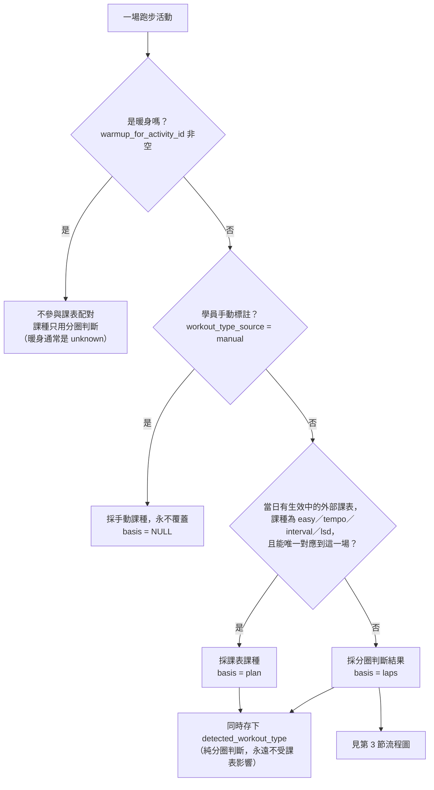
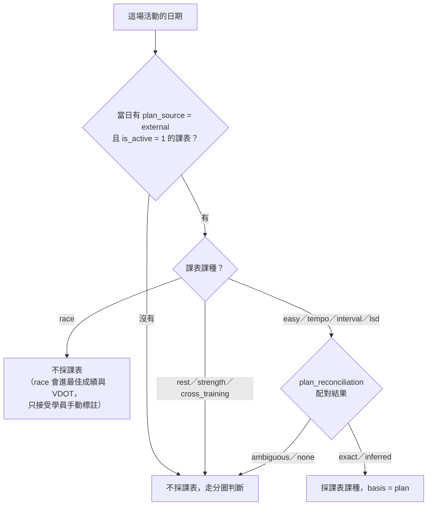
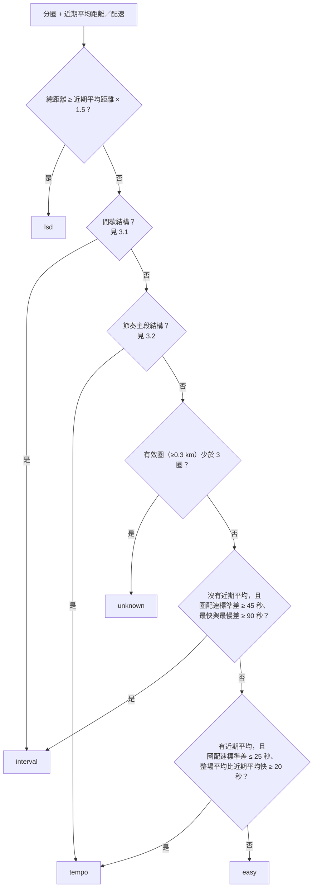
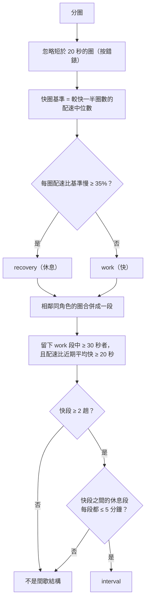
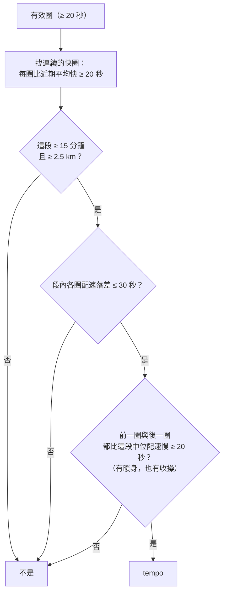
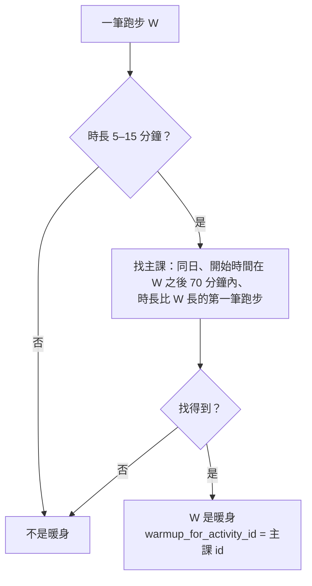

# 課種判定邏輯

> **最後更新**：2026-10-23（N-24／N-25／N-27／N-28）
> **範圍**：一場跑步的 `workout_type`（easy／tempo／interval／lsd／race／unknown）怎麼決定，以及暖身怎麼關聯到主課。
> 決策與理由見 [PLAN.md](PLAN.md) §1，待辦與驗收見 [TODO.md](TODO.md) N-24、N-25、N-27、N-28。
> 流程圖用 Mermaid，在 GitHub 與 VS Code（Markdown Preview Mermaid 外掛）可直接顯示。

## 1. 總覽：三層優先順序

`activities.workout_type` 是「**生效課種**」，依下列順序決定，前面成立就不看後面：



三個欄位的意思：

| 欄位 | 內容 |
|---|---|
| `workout_type` | 生效課種，教練與 Dashboard 看到的課種 |
| `workout_type_basis` | `plan`＝採課表的；`laps`＝採分圈判斷；`NULL`＝手動標註 |
| `detected_workout_type` | 純分圈判斷的結果。**與 `workout_type` 不同，代表「課表寫 X、分圈看起來像 Y」**，是遵從度分析的依據 |

> **為什麼課表排在分圈之前**：學員的暖身習慣分開按錶、重新計時，Garmin 分圈本身不區分暖身與主段，光靠配速結構猜課種，節奏跑這類「整場平均看不出來」的課會一再誤判。學員知道當天課表排什麼，那是比任何啟發式都可靠的資訊。
>
> **為什麼另存偵測結果**：`workout_type` 若被課表直接蓋掉，「課表與實際是否一致」的比對依據就永遠消失。

## 2. 第 2 層：外部課表怎麼配對



- **只看外部（跟團）課表**。系統自動產生的課表（`generated`）已全部停用，且曾與實際脫節 2.3 倍，不當參考。
- **配對**用 `plan_reconciliation.match_activity_to_plan`：同一天、運動類型相容。同日有兩場以上非暖身的跑步爭同一份課表時是 `ambiguous`，退回分圈判斷（目前資料沒有這種情形）。
- **暖身不參與配對**：同日候選活動會先排除暖身，課表對到主課。
- 課表寫入或更新後（`save_external_workouts`）會自動對受影響日期重算；課表被取代或移除後，該天自動退回分圈判斷。

## 3. 第 3 層：分圈判斷（沒有課表時）

輸入是 `activity_laps` 的分圈與「近期平均」。

**近期平均**：這場之前最近 **20** 場跑步的平均距離與平均配速。排除已關聯的暖身、排除越野跑（配速由地形決定）。



> 順序有意義：LSD 先看距離（即使圈數太少也能判）；結構規則（間歇、節奏主段）排在整場平均規則之前，因為整場平均會被暖身與休息稀釋。

### 3.1 間歇結構

錶設自動分圈時，一趟 1000 m 會被切成 400＋400＋約 200 m，所以**先把分圈合併成「趟」**再判斷。



- **門檻設 2 趟而不是 3**：課表「4000 m ＋ 休息 ＋ 2000 m」也是間歇。
- **每一趟都要夠快**：只看快慢交替會把「tempo 中途停一次」誤判成間歇。
- **休息 ≤ 5 分鐘**：長跑中途走路 7–20 分鐘，前後兩段都可能夠快，但那不是組間休息；學員的組間休息實測 2–4 分鐘。
- 沒有近期平均時，這條規則不判（無從判斷「快」）。

### 3.2 節奏主段結構

整場平均會被暖身與收操拉慢（2026-10-20：4 km @ 5:24 的主段，整場 5:48 只比近期平均快 6 秒），要先把主段切出來。



- **兩側都要有慢段**：試算顯示只要求單側時，會多抓約 20 場「起跑過快、之後放慢」的輕鬆跑，配速上與節奏跑分不出來。
- **已知取捨**：主段一直跑到結束、沒有收操的節奏跑，這條規則不判，會落到後面的整場平均規則或 easy。

## 4. 暖身怎麼關聯到主課

暖身常被分開計時，形成同日兩筆跑步。系統把它們關聯起來：場次清單不單獨列出暖身，改掛在主課上；分類器的近期平均排除暖身；負荷與跑量仍是兩筆分別計入。



- **跳過中間的短段**：暖身與主課之間若夾著約 2 分鐘被另存的短跑（較像第一趟反覆），它比暖身短，不會被誤當成主課。
- **不比配速**：間歇日主課的整場平均含組間休息，常比暖身慢，比配速會漏配。
- **70 分鐘**涵蓋賽事日（暖身後要走到起跑區，實測 56–65 分鐘）。
- 人工指定（`warmup_link_source = manual`）永不被覆寫；manual 且指向 NULL 代表「確認不是暖身」。

## 5. 生效課種怎麼影響品質評估

`assess_session_quality` 依生效課種決定評哪些維度：

| 生效課種 | 強度符合度 | 配速執行度 |
|---|---|---|
| easy／lsd | 整場平均心率對 59–74% HRR（手錶 Z2） | 整場平均配速對 VDOT 區間，**只有偏快才提示** |
| tempo | 整場平均心率對 75–88% HRR（自訂寬區間） | **不評**（整場平均含暖身收操，尚未建模主段） |
| interval | **不評**（短反覆心率還在爬升，平均心率會低估強度） | **逐趟**標示落在哪個 VDOT 區間（I／T／M／E 或區間之間），**不判定達標** |
| race | 整場平均心率對 85–100% HRR | 不評 |
| unknown／NULL | 不評 | 不評 |

課表是 interval、但分圈切不出 ≥2 趟時，配速維度列為不可評並說明原因，不猜。配速穩定度與心率漂移與課種無關，只看逐秒資料（API 同步的活動沒有逐秒資料，這兩項不可評）。

## 6. 什麼時候會重新判定

| 時機 | 做什麼 |
|---|---|
| Garmin 同步 | 先關聯暖身，再對新抓到分圈的活動分類（含課表優先） |
| FIT 匯入 | 匯入前先關聯暖身，再分類 |
| 外部課表寫入／更新 | 對受影響日期重新決定生效課種（用已存的偵測結果，不重跑分圈） |
| 手動 CLI | `python -m src.main.python.services.fit_import_runner --db-path ... --reclassify [--apply]`：重跑分圈分類並套用課表；預設只列差異、不寫入。暖身：`python -m src.main.python.services.warmup_links --db-path ... [--apply]` |

手動標註（`manual`）在所有時機都不會被覆蓋。

## 7. 門檻索引

全部為 🔴 工程決策、無文獻出處，依真實資料試算訂定；調整時改常數即可，不要散落到邏輯裡。

| 常數 | 值 | 檔案 | 用途 |
|---|---|---|---|
| `LSD_DISTANCE_RATIO` | 1.5 | workout_classifier | 距離 ≥ 近期平均 × 1.5 判 lsd |
| `MIN_LAP_DURATION_SEC` | 20 秒 | workout_classifier | 分段時忽略的碎圈 |
| `RECOVERY_SLOWER_RATIO` | 0.35 | workout_classifier | 比快圈基準慢 35% 以上算休息 |
| `MIN_WORK_SEGMENT_SEC` | 30 秒 | workout_classifier | 一趟 work 至少多長 |
| `INTERVAL_WORK_FASTER_THAN_AVG_SEC` | 20 秒 | workout_classifier | 每趟要比近期平均快多少 |
| `MIN_FAST_WORK_SEGMENTS` | 2 | workout_classifier | 至少幾趟快段 |
| `MAX_RECOVERY_SEGMENT_SEC` | 300 秒 | workout_classifier | 快段之間休息的上限 |
| `TEMPO_BLOCK_MIN_SEC`／`_MIN_KM` | 15 分鐘／2.5 km | workout_classifier | 節奏主段至少多長 |
| `TEMPO_BLOCK_MAX_SPREAD_SEC` | 30 秒 | workout_classifier | 主段內配速落差上限 |
| `TEMPO_BLOCK_NEIGHBOUR_SLOWER_SEC` | 20 秒 | workout_classifier | 暖身與收操要比主段慢多少 |
| `TEMPO_FASTER_THAN_AVG_SEC`／`TEMPO_MAX_STDEV_SEC` | 20 秒／25 秒 | workout_classifier | 整場平均規則的 tempo 門檻 |
| `INTERVAL_PACE_STDEV_SEC`／`_SPREAD_SEC` | 45 秒／90 秒 | workout_classifier | 沒有近期平均時的間歇備援 |
| `MIN_MEANINGFUL_LAP_KM`／`MIN_LAPS_FOR_CLASSIFICATION` | 0.3 km／3 圈 | workout_classifier | 整場平均規則的有效圈 |
| `RECENT_WINDOW` | 20 場 | fit_import_runner | 近期平均回看場數 |
| `WARMUP_MIN／MAX_DURATION_SEC` | 5／15 分鐘 | warmup_links | 暖身時長範圍 |
| `MAX_START_TO_START_SEC` | 70 分鐘 | warmup_links | 暖身開始到主課開始的上限 |
| `PLAN_DRIVEN_TYPES` | easy／tempo／interval／lsd | workout_type_resolution | 可由課表決定的課種（不含 race） |

## 8. 已知限制

- **沒有課表的場次，課種只是啟發式猜測**（`basis = laps`）。節奏跑沒有收操、輕鬆跑配速剛好符合節奏結構，都可能判錯；教練對這類場次應視為猜測。
- **2021–2023 年的 tempo 標記可信度低**：那段期間沒有刻意跑節奏跑，標記多半是舊規則（整場配速穩定且比近期平均快 20 秒）把跑得較快的輕鬆跑誤判（TODO N-27 遺留項目）。
- **課表只涵蓋 2026-10-12 之後**，更早的歷史完全靠分圈判斷。
- **同日多場非暖身的跑步**無法唯一對應課表，退回分圈判斷。
- **tempo 的配速執行度仍不評**；可沿用間歇的分段做法另開項目。

## 9. 怎麼檢查一場的判定

```sql
-- 生效課種、依據、偵測結果
SELECT id, date(started_at), workout_type, workout_type_basis, detected_workout_type,
       workout_type_source, warmup_for_activity_id
FROM activities WHERE id = ?;
```

MCP：`get_session_detail`／`list_running_sessions` 帶 `workout_type_basis` 與 `detected_workout_type`；`assess_session_quality` 的 `session` 區塊同樣帶這兩欄。`basis = plan` 且兩者不同時，教練應主動向學員說明。
